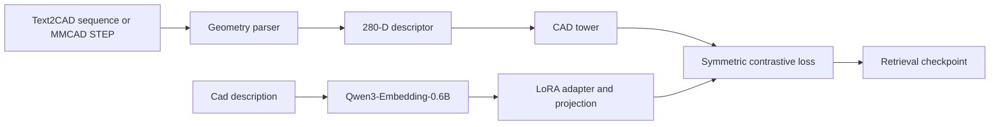

# Text-to-B-rep Retrieval
Text-to-CAD retrieval with a spectral CAD descriptor and a LoRA-adapted Qwen3-Embedding-0.6B text encoder.

[](https://www.python.org/)

---

### What it is
This repository contains the main retrieval experiment for Text2CAD and MMCAD-B. Both datasets use the same model structure: a 280-D geometric descriptor feeds a residual CAD tower, text feeds a Qwen3-Embedding-0.6B encoder with LoRA, and the two normalized embeddings are trained with symmetric one-pair contrastive loss.

The data path starts from the original Text2CAD construction sequences or original MMCAD-B STEP files. Models, datasets, descriptor caches, adapters, checkpoints, and metrics stay outside Git.

---

### Quick start
Install a CUDA-enabled PyTorch build for the host, then install the package.

```bash
python -m pip install -e .
```

Download [Qwen3-Embedding-0.6B](https://huggingface.co/Qwen/Qwen3-Embedding-0.6B) to the relative `models/Qwen3-Embedding-0.6B` directory.

For Text2CAD, download the [Text2CAD dataset](https://huggingface.co/datasets/SadilKhan/Text2CAD) and the project resources from [Text2CAD](https://github.com/SadilKhan/Text2CAD). Use this layout:

```text
data/Text2CAD/
  text2cad_v1.0/
    text2cad_v1.0.csv
    train_test_val.json
  cad_seq.zip
```

Build the Text2CAD cache:

```bash
bash scripts/prepare_text2cad.sh
```

Train the Text2CAD model:

```bash
bash scripts/train_text2cad.sh
```

Evaluate the Text2CAD checkpoint:

```bash
bash scripts/evaluate_text2cad.sh
```

For MMCAD-B, download the [MMCAD dataset](https://huggingface.co/datasets/exanos/MMCAD), including `mmcad_b/metadata.parquet` and the STEP shards. Place the metadata and extracted STEP files or tar archives under this layout:

```text
data/MMCAD-B/
  metadata.parquet
  steps/
    step-00000/
    step-00001/
```

Build the MMCAD-B cache:

```bash
bash scripts/prepare_mmcad.sh
```

Train and evaluate MMCAD-B:

```bash
bash scripts/train_mmcad.sh
```

```bash
bash scripts/evaluate_mmcad.sh
```

Every script reads path and resource variables from the environment. The common variables are `PYTHON_BIN`, `CACHE`, `MODEL`, `OUTPUT_DIR`, `CHECKPOINT`, `NPROC`, `BATCH_PER_DEVICE`, `WORKERS`, `EPOCHS`, and `TEST_SIZE`.

---

### Architecture


The Text2CAD processor reads `cad_seq.zip` or an extracted `cad_seq` tree. The MMCAD-B processor validates single-solid STEP parts, verifies the selected planar cap as an extrusion profile, computes the descriptor, removes validation examples that duplicate training geometry, and samples a fixed test set.

---

### Training protocol
The Text2CAD preset uses two GPUs, 512 samples per device, a global contrastive batch of 1024, three epochs, LoRA rank 16, and LoRA alpha 32.

The MMCAD-B preset uses seven GPUs, 96 samples per device, a global contrastive batch of 672, three epochs, LoRA rank 32, and LoRA alpha 64.

Both presets use AdamW with weight decay `0.01`, OneCycleLR with warmup fraction `0.05`, temperature `0.05`, maximum text length `320`, gradient clipping at `1.0`, and symmetric in-batch contrastive loss. The text loss is one text description against its matching CAD model.

Output files:

| File | Purpose |
|---|---|
| `config.json` | Resolved training arguments and data counts |
| `training_curve.csv` | Per-epoch loss and learning rate |
| `adapter` | LoRA weights and tokenizer |
| `retrieval.pt` | CAD tower, text projection, normalization statistics, and configuration |
| `test_metrics.json` | Recall metrics generated by evaluation |

---

### Configuration
Run any command with `--help` for all accepted options:

```bash
cadret train --help
```

The descriptor cache is specific to its dataset and preprocessing settings. Rebuild the cache after changing the input files or descriptor code.

Use `CUDA_VISIBLE_DEVICES` to select GPUs and set `NPROC` to the number of selected GPUs. Keep the global product `NPROC * BATCH_PER_DEVICE` fixed when changing the hardware allocation.

---

### Tests
The tests use synthetic CAD data and do not need the downloaded datasets or model weights:

```bash
python -m unittest discover -s tests -v
```

---

### Documentation map
| Document | What it covers |
|---|---|
| [README.md](README.md) | Dataset sources, setup, data processing, training, evaluation, and outputs |
| [pyproject.toml](pyproject.toml) | Package metadata and dependencies |
| [scripts/prepare_text2cad.sh](scripts/prepare_text2cad.sh) | Text2CAD descriptor cache |
| [scripts/prepare_mmcad.sh](scripts/prepare_mmcad.sh) | MMCAD-B STEP descriptor cache |
| [scripts/train_text2cad.sh](scripts/train_text2cad.sh) | Text2CAD LoRA training |
| [scripts/train_mmcad.sh](scripts/train_mmcad.sh) | MMCAD-B LoRA training |
| [scripts/evaluate_text2cad.sh](scripts/evaluate_text2cad.sh) | Text2CAD retrieval evaluation |
| [scripts/evaluate_mmcad.sh](scripts/evaluate_mmcad.sh) | MMCAD-B retrieval evaluation |
