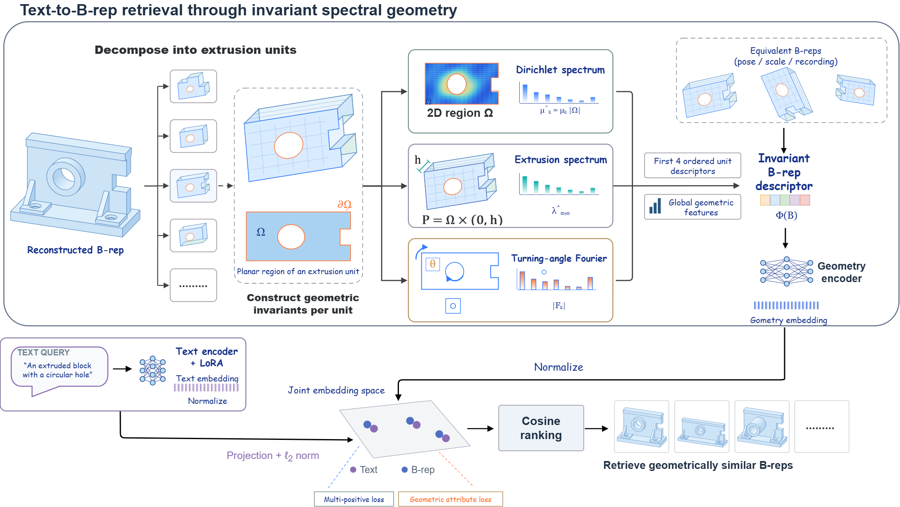

# Text-to-B-rep Retrieval

Text-to-CAD retrieval with spectral geometric descriptors and a LoRA-adapted Qwen3 text encoder.

---

### Quick start

Use Python 3.10 or newer. LoRA training requires Linux, a CUDA GPU, and a CUDA-enabled PyTorch installation.

Install from the repository root:

```bash
python -m pip install -e .
```

Prepare the Text2CAD dataset with this layout:

```text
Text2CAD/
  text2cad_v1.0/
    text2cad_v1.0.csv
    train_test_val.json
  cad_seq.zip
```

Build the CAD descriptor cache:

```bash
cadret prepare --data_dir /path/to/Text2CAD --output_dir runs --workers 4
```

Train the retrieval model. Set `--nproc_per_node` to the number of GPUs to use:

```bash
torchrun --standalone --nproc_per_node=1 -m cadret train --data_dir /path/to/Text2CAD --output_dir runs
```

Evaluate the checkpoint produced by training:

```bash
cadret evaluate --data_dir /path/to/Text2CAD --checkpoint runs/lora_cad.pt
```

List all commands, including frozen-text training and descriptor validation:

```bash
cadret --help
```

---

### Model checkpoint

The included [CAD checkpoint](model/lora_cad.pt) contains the CAD encoder weights and descriptor normalization statistics. Complete text-to-CAD evaluation also requires trained text projection layers and a LoRA adapter. The training command above saves these together in its output directory.

---

### Architecture



---

### Tests

```bash
python -m unittest discover -s tests -v
```

The distributed integration test runs when a usable Gloo network device is available.

---

### Project files

| Path | Purpose |
|---|---|
| [src/cadret/data](src/cadret/data) | Dataset loading and feature preparation |
| [src/cadret/geometry](src/cadret/geometry) | Geometry parsing and spectral descriptors |
| [src/cadret/models](src/cadret/models) | CAD and text encoders |
| [src/cadret/training](src/cadret/training) | Training objectives and distributed training |
| [src/cadret/evaluation](src/cadret/evaluation) | Retrieval metrics and evaluation |
| [scripts](scripts) | Shell entry points |
| [tests](tests) | Automated checks |
| [pyproject.toml](pyproject.toml) | Installation and tooling configuration |
| [README.md](README.md) | Setup and usage |
